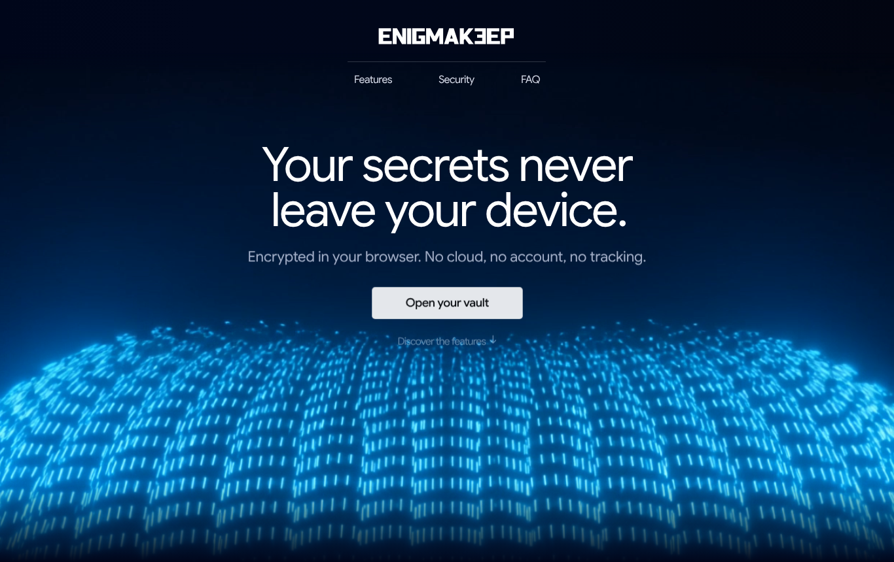
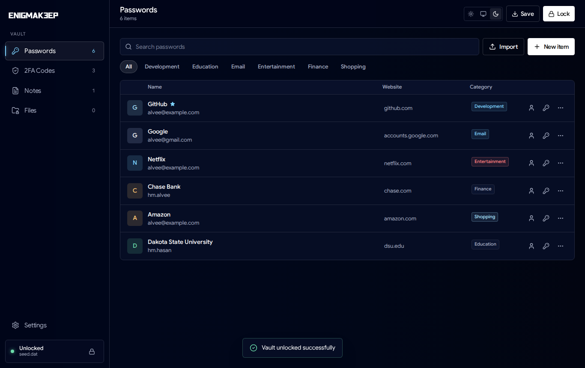
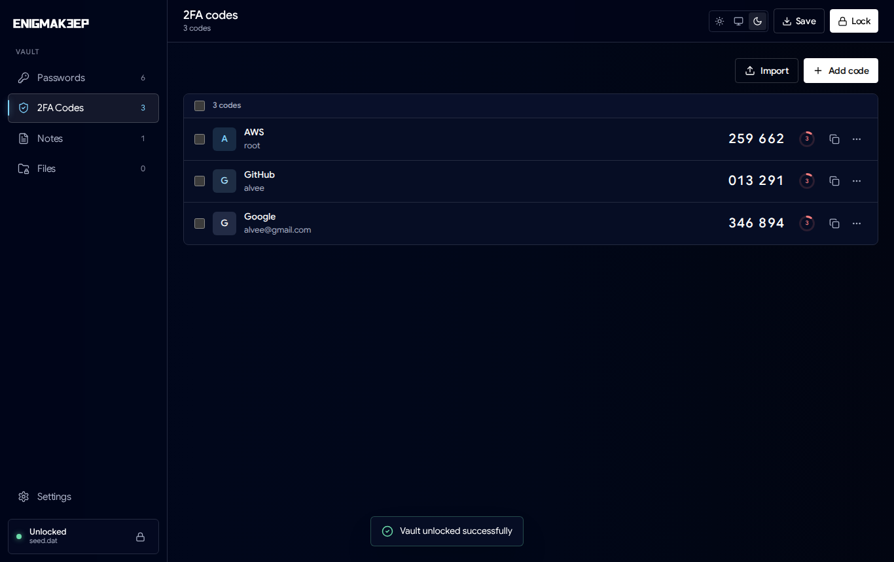
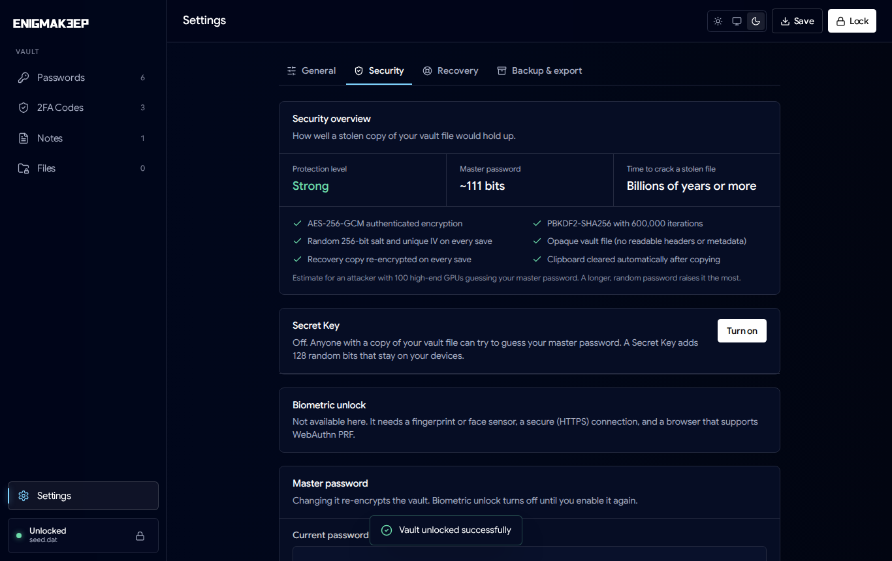
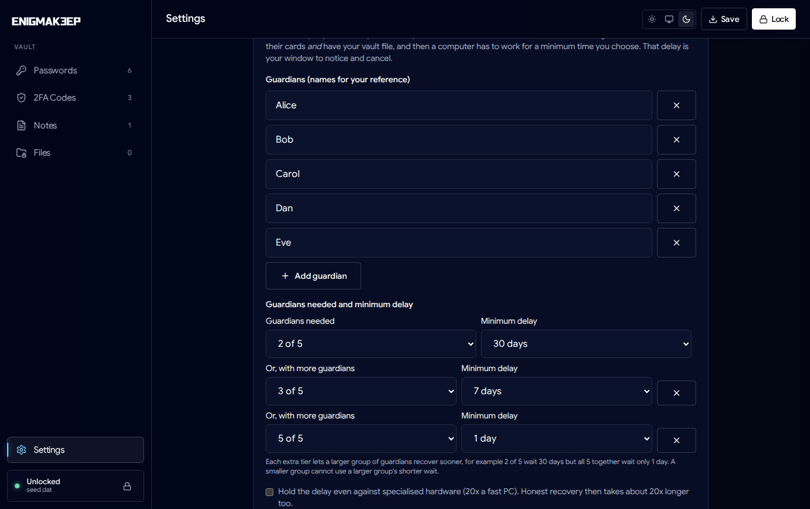
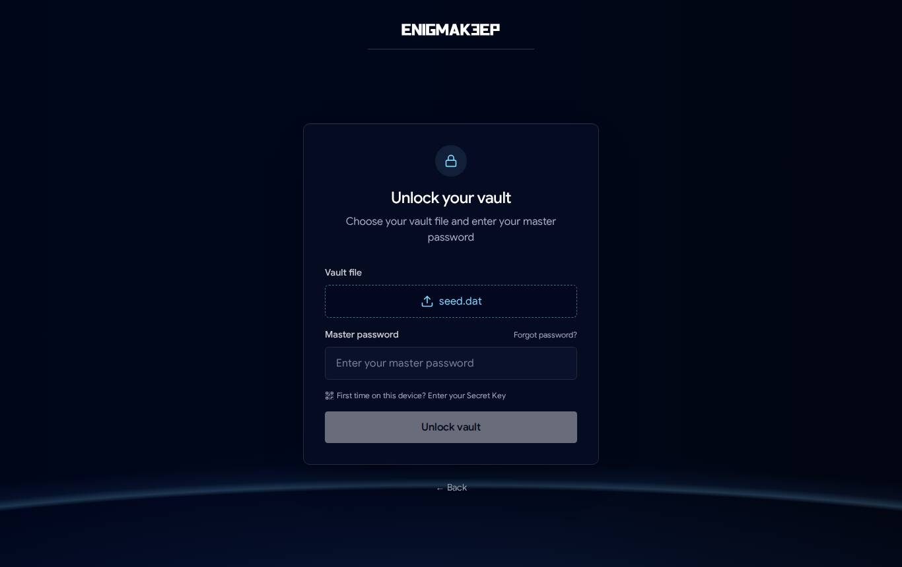
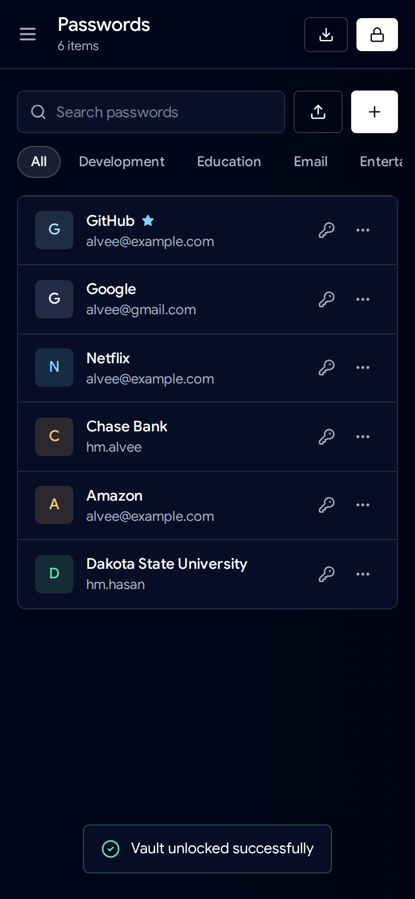

# EnigmaKeep

EnigmaKeep is a password manager that runs in your browser and keeps everything on your own devices. There is no account to create and no server holding your vault. Your passwords, two-factor codes, notes and files live in one encrypted file that only you can open.

- Website: [enigmakeep.com](https://enigmakeep.com/)
- Source: [github.com/hmalvee/EnigmaKeep](https://github.com/hmalvee/EnigmaKeep)
- Maintainer: HM Alvee Hasan ([@hmalvee](https://github.com/hmalvee))
- Licence: [AGPL-3.0](LICENSE) for the app, [MIT](src/crypto/LICENSE) for the cryptography in `src/crypto/` (see [LICENSING.md](LICENSING.md))

What changed in each version is in [CHANGELOG.md](CHANGELOG.md).

## Screenshots



| | |
|---|---|
|  |  |
| Passwords, with copy buttons and a per-entry menu | Two-factor codes with a countdown |
|  |  |
| Security settings: Secret Key, biometrics, master password | Guardian recovery with a graded delay: more guardians, shorter wait |
|  |  |
| Unlock with the master password, Secret Key or biometrics | The same vault on a phone |

## What it does

The app stores logins, TOTP codes, secure notes and arbitrary files (with folders, preview and editing) inside the vault. It generates passwords, checks their strength and imports from 1Password, Bitwarden, LastPass, Chrome and CSV or JSON exports. You can install it as a PWA on desktop and mobile, and it works offline once loaded.

On the security side:

| | How it works |
|---|---|
| Vault encryption | AES-256-GCM, fresh random salt and nonce on every save |
| Unlocking | Master password through PBKDF2-SHA-256 (600,000 iterations), combined with a 128-bit Secret Key kept on your devices (HKDF). A stolen vault file can't be brute-forced from the password alone. |
| New devices | Scan the Secret Key's QR code from your printed Emergency Kit, once per device |
| Biometric unlock | WebAuthn PRF: the key that wraps your master password only exists after your device's authenticator verifies you |
| Recovery phrase | 12-word BIP-39 phrase that opens a separate, always-current recovery copy of the vault |
| Guardian recovery | Optional. Trusted people hold shares; a set number of them plus the vault file plus a minimum delay of sequential computation are needed, so you have time to notice and cancel. The delay can shrink as more guardians cooperate, and the puzzle is replaced on every save, so a finished recovery opens only the version it started from. |
| Decoy vault | Optional. A duress password opens a harmless decoy from the same file; the real vault hides in random padding that every file carries, so a single copy of the file cannot show that a hidden vault exists |
| Rollback detection | Each save is stamped inside the ciphertext; a device warns when a file is older than the version it last opened |
| Vault file | Header-less blocks of ciphertext followed by random padding; no readable metadata |
| In the browser | Strict Content Security Policy in production, auto-lock, clipboard clearing, local encrypted snapshots |

If you lose the master password, the Secret Key, the recovery phrase and your guardians' cards, nobody can open the vault, including us. That is the point of zero knowledge, so keep your Emergency Kit and recovery phrase somewhere safe.

Report vulnerabilities as described in [SECURITY.md](SECURITY.md).

## Benchmark your device

Guardian recovery makes a computer work for the delay the owner chose, and browsers are slower at this than native code. Open `/bench` (for example [enigmakeep.com/bench](https://enigmakeep.com/bench)) to measure your own device in about 30 seconds and see what a 1-, 7- or 30-day delay would mean on it.

## Quick start

```bash
git clone https://github.com/hmalvee/EnigmaKeep.git
cd EnigmaKeep
npm install
npm run dev        # http://localhost:5173
```

`npm run build` writes a static site to `dist/`, which you can host anywhere (Netlify, GitHub Pages, your own server). The `netlify.toml` file contains the production security headers; copy them if you host elsewhere.

## Scripts

| Command | What it does |
|---|---|
| `npm run dev` | Development server |
| `npm run build` / `npm run preview` | Production build and local preview |
| `npm run lint` / `npm run typecheck` | ESLint and TypeScript checks |

## Repository layout

```
src/
  crypto/        encryption, vault format, Secret Key, recovery phrase,
                 Shamir sharing, time-lock puzzles, guardian recovery
  utils/         vault manager, storage, biometric unlock, import/export
  components/    vault UI, login and recovery screens, settings
  workers/       background solver for guardian recovery
  pages/, site/  marketing site, blog and legal pages
public/          static assets, icons, PWA manifest
screenshots/     images used in this README
scripts/         build helpers
```

## Contributing

See [CONTRIBUTING.md](CONTRIBUTING.md). Never paste recovery phrases, Secret Keys or vault files into issues.

## Support

- Bugs and ideas: [issues](https://github.com/hmalvee/EnigmaKeep/issues)
- Questions: [discussions](https://github.com/hmalvee/EnigmaKeep/discussions)
- Security reports: [SECURITY.md](SECURITY.md)
